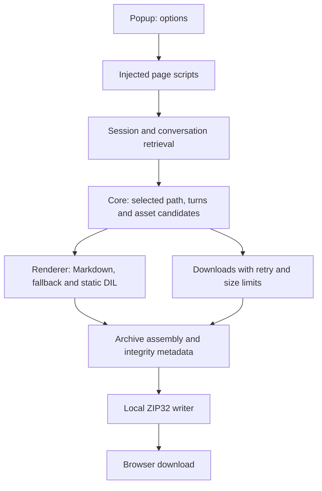

# Architecture (v0.3.9.2)

This is a Chrome Manifest V3 extension without a persistent background service worker. `popup.js` injects `zip.js`, `renderer.js`, `core.js`, `reliability.js`, and `page.js` into the active ChatGPT tab using `chrome.scripting`. A page-side export panel reports progress and provides download links. Auto-loaded ChatGPT-only content scripts also expose a bottom-right DOM button for agent-based export. The Popup controls its visibility via a default-on `chrome.storage.local` preference; `dom-button.js` listens to `chrome.storage.onChanged`, updates all open tabs without a reload, and does not interrupt running exports.

## Source preference and fidelity

The extension requests the current chat from ChatGPT API endpoints, including pagination when available; a DOM fallback can be incomplete. It filters service/reasoning records from the **readable transcript** while keeping returned raw content in `conversation.json`. `renderer.js` uses accessible `fallbackMarkdown` when appropriate, preserving original code blocks and supported mathematical notation. Supported static DIL templates can yield missing visible labels. Dynamic code is **never evaluated**. Original DIL files are retained for inspection.

## Assets and media

`core.js` finds explicit sandbox links, attachment metadata, safe inline SVG, and `image_asset_pointer` references in tool messages. The latter are candidates only; their relationship to a visible answer can be inferred rather than exact. `page.js` attempts authorized downloads sequentially. On success bytes and integrity metadata are recorded; on failure the candidate remains in the report without a fake local link. User uploads are skipped by default.

## Integrity and limitations

`zip.js` writes uncompressed ZIP32 entries locally with CRC32; downloaded assets can have SHA-256. The overall download budget is 512 MiB, with per-file popup limits. Export completeness is qualified because neither all branches nor hidden server content are guaranteed accessible. See [privacy](privacy.md) and [export format](export-format.md).
