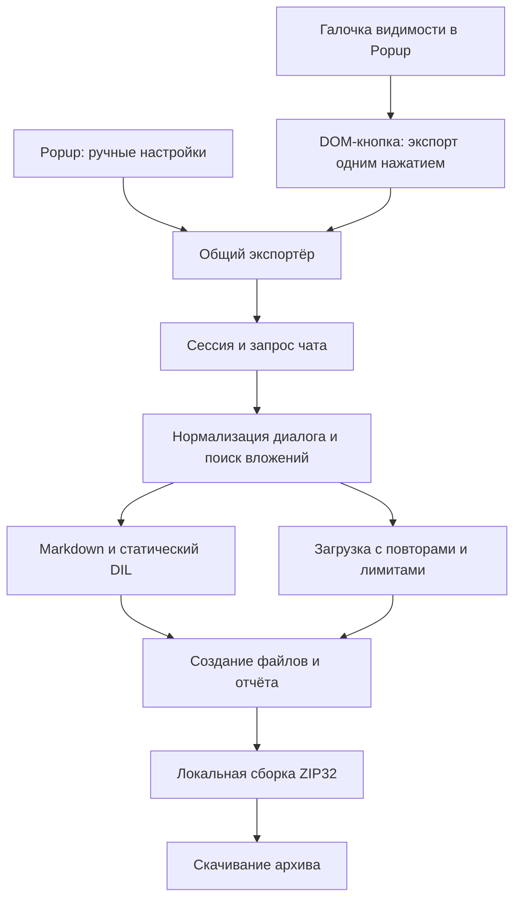

# Архитектура (v0.3.9.2)

Это расширение Chrome Manifest V3 без постоянно работающего service worker. `popup.js` внедряет `zip.js`, `renderer.js`, `core.js`, `reliability.js` и `page.js` в открытую вкладку ChatGPT через `chrome.scripting`. Панель на странице показывает ход экспорта и ссылки скачивания. Скрипты ChatGPT также загружаются автоматически для DOM-кнопки агента; первая галочка Popup управляет её видимостью через `chrome.storage.local` и `chrome.storage.onChanged`. Кнопка появляется/исчезает сразу во всех вкладках без отмены уже запущенного экспорта.

## Достоверность

Расширение получает текущий разговор через API ChatGPT, проверяет доступные страницы; при необходимости использует потенциально неполный DOM-резерв. Служебные сообщения исключаются из **читаемой переписки**, но доступный сырой JSON сохраняется. `renderer.js` использует пригодный `fallbackMarkdown`, защищает исходный код и поддерживаемые формулы; умеет восстанавливать подписи некоторых статических DIL-шаблонов. Произвольный JS из DIL **не выполняется**. Исходники сложных компонентов сохраняются отдельно.

## Вложения и изображения

`core.js` учитывает sandbox-ссылки, метаданные вложений, безопасные SVG и `image_asset_pointer` из ответов инструментов. Указатели — лишь кандидаты; привязка к сообщению бывает предположительной. `page.js` скачивает последовательно и сообщает о настоящем результате. Недоступные файлы остаются в отчёте без ложных локальных ссылок. Входящие материалы по умолчанию не скачиваются.

## Контроль

`zip.js` создаёт ZIP32 в режиме STORE с CRC32; скачанные файлы могут иметь SHA-256. Бюджет вложений — 512 МиБ, индивидуальный лимит задаёт пользователь. Полнота истории не гарантируется: скрытые данные и альтернативные ветки могут отсутствовать. Подробнее: [Приватность](privacy.ru.md), [Формат](export-format.ru.md).
